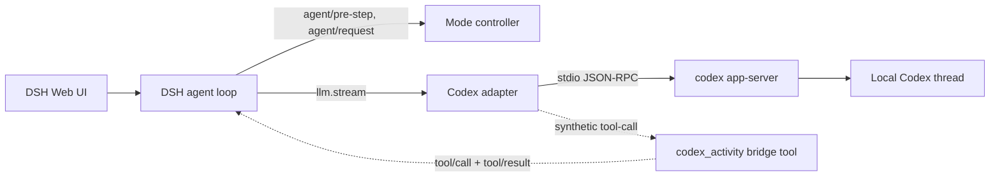

<p align="center">
  
</p>

<h1 align="center">Local Codex Mode</h1>

<p align="center"><b>Give one DeepSeek Harness session to your local Codex CLI — and watch it work inline.</b></p>

<p align="center">
  <a href="https://github.com/Anzerwhite/dsh-local-codex/releases"></a>
  <a href="./LICENSE"></a>
  
  
  
  <a href="https://github.com/Anzerwhite/dsh-local-codex/stargazers"></a>
</p>

<p align="center">
  <a href="./README.zh.md">中文</a> ·
  <a href="#install">Install</a> ·
  <a href="#quick-start">Quick start</a> ·
  <a href="#configuration">Configuration</a> ·
  <a href="./docs/design.md">Design</a> ·
  <a href="./CHANGELOG.md">Changelog</a>
</p>

`dsh-local-codex` is a Host plugin for [DeepSeek Harness](https://github.com/deepseek-ai/deepseek-harness) (DSH) that hands **one session** to your local **Codex CLI**. Say “使用codex模式” (or run `/codex on`) and that conversation switches to Codex: replies stream into the existing chat, and every command or file change Codex performs shows up as a native, collapsible tool card in the same conversation.

The mode is **per session**. New sessions and forks start with it off, DSH restarts resume the same Codex thread, and one session switching to Codex never changes how the rest of your DSH workspace behaves.

```text
You:   使用codex模式：跑一下单元测试，失败的话修掉
DSH:   ✓ Codex Mode enabled for this session → codex/<your Codex model>
Codex: I'll run the test suite first.
       ▸ codex_activity   (pnpm test — exit code 1)
       …
       Fixed the failing assertion and re-ran the suite.
```

## Table of Contents

- [Why Local Codex Mode](#why-local-codex-mode)
- [Features](#features)
- [Requirements & compatibility](#requirements--compatibility)
- [Install](#install)
- [Quick start](#quick-start)
- [Trigger phrases & commands](#trigger-phrases--commands)
- [Configuration](#configuration)
- [How it works](#how-it-works)
- [Permissions & security](#permissions--security)
- [Limitations](#limitations)
- [Troubleshooting](#troubleshooting)
- [Roadmap](#roadmap)
- [Development](#development)
- [License](#license)

## Why Local Codex Mode

- **Use the Codex you already configured.** Same `~/.codex/config.toml`, same provider, same model, same hooks, skills and plugins — no second account and no re-login.
- **No context copying.** The DSH session *is* the Codex conversation. You keep one timeline instead of pasting prompts between a chat window and a terminal.
- **Native DSH experience.** Streaming replies, tool cards, approval cards, Stop, session history, persistence and new-session behavior all come from DSH itself.
- **Scoped by design.** Only the session you enabled is affected; new sessions, forks and every other DSH session keep their normal model and tools.
- **Nothing leaks behind.** `/codex off` restores the previous DSH model route and releases the Codex thread so native Codex can reopen it.

## Features

| Feature | Detail |
| --- | --- |
| Per-session takeover | A trigger word or `/codex on\|off\|status` controls one session; DSH's model and tools step aside only there. |
| Inline streaming | Codex text streams through DSH's standard assistant stream. |
| Native tool cards | Command executions, file changes, MCP calls and web searches become real `tool/call` + `tool/result` events rendered by DSH's collapsible tool cards. |
| Local Codex runtime | Drives `codex app-server` with your Codex config; one Codex thread per DSH session. |
| Thinking effort | `minimal` / `low` / `medium` / `high` / `xhigh` exposed to DSH and forwarded per turn (`max` → `xhigh`). |
| Session persistence | Mode + Codex thread id are stored per session; DSH restarts resume the same thread. |
| DSH-authoritative permissions | Session sandbox/approval presets are mapped onto Codex's per-turn `sandboxPolicy` / `approvalPolicy`; Codex approvals appear as DSH approval cards. |
| Clean stop & recovery | Stop interrupts the active Codex turn and keeps partial output; failures surface an error and rebuild the app-server. |
| Thread lease release | `/codex off` unsubscribes the Codex thread, and the app-server unloads it immediately so native Codex can reopen the session. |
| Attachments | Composer images become `localImage` inputs; files are materialized on disk and their path is passed to Codex. |
| Zero client code | Everything renders through standard DSH session events and the existing Web UI. |

## Requirements & compatibility

| Component | Version / requirement |
| --- | --- |
| DeepSeek Harness | `0.2.1-rc.x`, Web profile (Host-only plugin; no client bundle) |
| Codex CLI | `0.170.x` — default path `/root/.npm-global/bin/codex`, override with `codexBin` |
| Codex configuration | `~/.codex/config.toml` (custom providers supported; `codex login` only if your provider needs it) |
| Package manager | `pnpm` available to the profile (used by DSH Plugin Manager to install `zod`) |
| Model access | A provider reachable by your Codex installation; the plugin does not manage Codex credentials |
| Platform | Wherever DSH and Codex CLI run; the default `codexBin` is a Linux path, so set `codexBin` explicitly on other platforms |

> `codex app-server` is an experimental Codex surface. This release pins the Codex CLI **0.170.x** protocol baseline and tolerates unknown notifications; upgrading Codex may require a compatibility pass.

## Install

### From the plugin market / prebuilt release tarball

```sh
dsh plugin --profile web add https://github.com/Anzerwhite/dsh-local-codex/releases/download/v0.1.0/dsh-local-codex-0.1.0.tgz
```

This is the same prebuilt tarball the DSH plugin market serves. The plugin is listed in the community catalog: <https://awesome-dsh-plugin.com/p/Anzerwhite/dsh-local-codex/> — reload the DSH page and search `dsh-local-codex` in **Plugins → Discover**. The release tarball installs the same artifact immediately.

### From npm (after the npm release)

```sh
dsh plugin --profile web add dsh-local-codex
```

### From source (development)

```sh
git clone https://github.com/Anzerwhite/dsh-local-codex.git
cd dsh-local-codex
dsh plugin --profile web add -w "$PWD"
```

After changing source files, toggle the bundle off/on in **Plugins** (or restart `dsh web`) to load the new module generation.

### Uninstall

```sh
dsh plugin --profile web remove dsh-local-codex
```

Removing the plugin keeps each session's saved mode record (harmless) and releases Codex threads it held.

## Quick start

1. Install the plugin and restart or reload the DSH profile.
2. Open a session — the model picker still shows your usual DSH model.
3. Send `使用codex模式` (or `/codex on`), then talk to Codex as usual.

## Trigger phrases & commands

Sentence-initial, case-insensitive. The trigger itself never enters the model transcript.

| Action | What to send |
| --- | --- |
| Enable (no content) | `使用codex模式` / `开启codex模式` / `进入codex模式` / `切换到codex模式` / `use codex mode` / `enable codex mode` / `enter codex mode` / `codex mode on` |
| Enable and run content | `使用codex模式：帮我修复这个测试` — enables mode and sends “帮我修复这个测试” as the first Codex turn |
| Disable | `退出codex模式` / `关闭codex模式` / `结束codex模式` / `exit codex mode` / `disable codex mode` / `codex mode off` |
| Explicit control | `/codex on` · `/codex off` · `/codex status` |

While mode is on, the session's model shows as `codex/<your Codex model>`; `/codex status` reports the model, thinking effort and Codex thread id.

## Configuration

Configuration is optional; defaults target a standard local Codex install. Add a `config` block to the plugin row in your profile patch (`cordis.patch.yml`) to override them:

```yaml
- id: codex-mode
  config:
    codexBin: /root/.npm-global/bin/codex
    reasoningEffort: xhigh
```

| Key | Default | Meaning |
| --- | --- | --- |
| `codexBin` | `/root/.npm-global/bin/codex` | Codex CLI executable. |
| `providerName` | `codex` | LLM provider route registered with DSH. |
| `model` | `model` in `~/.codex/config.toml` | Model id exposed to the DSH picker. |
| `cwd` | session working directory | Override the Codex thread working directory. |
| `requestTimeoutMs` | `60000` | app-server request timeout. |
| `bootstrapLimitChars` | `24000` | Character budget of the history digest injected once when the Codex thread is created. |
| `reasoningEffort` | Codex config `model_reasoning_effort` | Default thinking effort. |
| `reasoningSummary` | Codex config | Per-turn summary override (`auto` / `concise` / `detailed` / `none`). |
| `codexEfforts` | five built-in tiers | Thinking tiers exposed to DSH. |
| `maxBridgeCallsPerTurn` | `200` | Safety budget for bridged Codex actions in one user turn. |
| `defaultSandbox` / `defaultApproval` | `danger-full-access` / `never` | Fallback when the DSH permission preset cannot be read. |
| `attachmentsDir` | system temp dir | Where image/file attachments are materialized. |

## How it works



The plugin registers an **LLM provider adapter** that drives `codex app-server` — one Codex thread per DSH session. Assistant text and reasoning travel through standard stream chunks; tool activity is bridged into real session events so the existing chat UI renders it natively. A mode controller owns session state, model routing and permission mapping. No DSH core changes, no custom client bundle.

| Fact | Value |
| --- | --- |
| npm package | `dsh-local-codex` |
| Bundle row id | `codex-mode` |
| LLM provider route | `codex` |
| Display-only tool | `codex_activity` |
| Client bundle | none (Host-only) |

Further reading: [design](docs/design.md) · [architecture decisions](docs/adr/) · [implementation contract](docs/impl-contract.md) · [verification log](docs/verification.md).

## Permissions & security

- **DSH preset is authoritative.** Each Codex turn receives sandbox/approval mapped from the DSH session's permission preset (`read-only` / `workspace-write` / `danger-full-access`). With the `danger-full-access` preset, Codex commands run with full local access — choose a stricter preset first if that is not what you want.
- **Approvals** raised by Codex become DSH approval cards; declining or cancelling ends that Codex action.
- **Thread lease.** While mode is on, DSH holds the Codex thread and native Codex reports the session as busy. `/codex off`, agent disposal or plugin unload release it.
- **Privacy.** Conversation content is sent to the model provider named in your Codex configuration — the same trust boundary as running Codex directly.
- **Minimal surface.** The plugin registers exactly one display-only tool (`codex_activity`), never re-runs Codex commands, and adds no network endpoints.
- **Secrets.** DSH approval and permission settings are respected; the plugin never reads your Codex auth files.

## Limitations

- The first turn of a resumed Codex thread can take 5–30 s (Codex hooks/skills load); there is no progress indicator yet.
- Reasoning *text* is provider-dependent: some providers return only reasoning token counts. The thinking tier is still visible and selectable.
- Attachments are implemented but not yet heavily battle-tested; very large tool output is capped by DSH's spill policy.
- If another plugin also spawns `codex app-server` (for example a remote-workspace plugin), prefer running one at a time to avoid thread-writer contention.
- Generic DSH tool cards are used for Codex actions; native terminal/diff cards are on the roadmap.

## Troubleshooting

| Symptom | Fix |
| --- | --- |
| `/codex status` shows thread “(not created yet)” right after enabling | Normal — the thread is created on the next message. |
| Native Codex says the session is locked | Codex mode still holds the thread; run `/codex off` first. |
| First reply after enabling is slow | Thread creation/resume plus Codex hooks can take seconds; later turns are fast. |
| Model picker does not show the codex model | Confirm the plugin is active under **Plugins → Installed** and that `codexBin` points to a working Codex CLI. |
| A trigger phrase does nothing | It must start the message; use `/codex on` as a fallback. |
| Plugin fails to activate | The profile needs `pnpm` for dependency installation; check DSH logs for the failing row. |

## Roadmap

- npm publication (the community-catalog listing is already merged).
- Optional native terminal / diff card rendering for Codex actions.
- End-to-end coverage for attachments and Codex approval round-trips.
- Progress indicator while a Codex thread is resumed.

## Development

```sh
node test/scenarios.mjs            # headless end-to-end scenarios (S1–S3)
node test/run-headless.mjs --help  # one-shot headless runner with assertions
```

Read [docs/impl-contract.md](docs/impl-contract.md) before changing module boundaries. `src/` is plain ESM JavaScript with no build step.

## License

[MIT](./LICENSE)

---

<sub>Not affiliated with OpenAI or DeepSeek. Codex is a CLI from OpenAI; DeepSeek Harness is a separate project. This plugin only connects the two locally.</sub>
