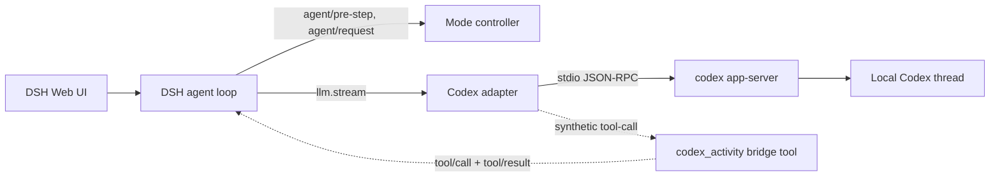

<p align="center">
  
</p>

<h1 align="center">Local Codex Mode</h1>

<p align="center">
  Give one DeepSeek Harness session to your local Codex CLI — and watch it work inline.
</p>

<p align="center">
  <a href="./README.zh.md">中文</a> ·
  <a href="https://github.com/Anzerwhite/dsh-local-codex/releases">Releases</a> ·
  <a href="./LICENSE">MIT License</a> ·
  <a href="./docs/design.md">Design</a>
</p>

`dsh-local-codex` is a Host plugin for [DeepSeek Harness](https://github.com/deepseek-ai/deepseek-harness) (DSH) that turns **one session** into a local Codex session. Say “使用codex模式” (or run `/codex on`) and that conversation is handed to your local **Codex CLI**: replies stream into the existing chat, and every command or file change Codex performs appears as a native, collapsible tool card in the same conversation.

Mode is **per session**: new sessions and forks start with it off, and DSH restarts resume the same Codex thread. No separate window, no copy-pasted transcript — the DSH conversation *is* the Codex conversation.

> Status: `0.1.0` · DSH `0.2.1-rc.x` · Codex CLI `0.170.x` · Host-only, no client plugin required

## Features

- **One-session takeover** — a trigger word or `/codex on` hands the session to the local Codex CLI; DSH's own model and tools step aside for that session only.
- **Inline sync** — Codex text streams through DSH's normal assistant stream; command executions, file changes, MCP calls and web searches become real `tool/call` / `tool/result` events, rendered by DSH's native collapsible tool cards.
- **Your machine, your Codex** — the local `codex app-server` runs with your `~/.codex/config.toml`: model, provider, auth, hooks, skills and plugins are exactly what you use in Codex.
- **Thinking effort** — the model exposes Codex reasoning tiers (`minimal` / `low` / `medium` / `high` / `xhigh`); the selected tier is forwarded per turn (`max` maps to `xhigh`).
- **Session-scoped, persistent** — mode + Codex thread id are stored per session. Reopen the session after a DSH restart and the same Codex thread is resumed; new sessions and forks are off.
- **DSH permission presets stay authoritative** — the session's sandbox/approval preset is mapped onto Codex's per-turn `sandboxPolicy` / `approvalPolicy`; Codex approval requests surface as DSH approval cards.
- **Clean stop & failure handling** — Stop interrupts the current Codex turn (partial output is kept), failures show a readable error and rebuild the app-server on the next turn.
- **No thread lock left behind** — `/codex off` unsubscribes the Codex thread and the app-server is configured to unload it immediately, so your native Codex TUI can reopen the session right away.
- **Attachments** — composer images are passed to Codex as `localImage`; files are materialized on disk and their path is given to Codex.
- **Zero client code** — everything renders through standard DSH session events and the existing Web UI.

## Requirements

| Requirement | Notes |
| --- | --- |
| DeepSeek Harness `0.2.1-rc.x` | Web profile. The plugin is Host-only. |
| Codex CLI `0.170.x` | Default path `/root/.npm-global/bin/codex`; override with `codexBin`. Uses `~/.codex/config.toml` (custom providers included; `codex login` is only needed if your provider requires it). |
| `pnpm` available to the profile | DSH Plugin Manager uses it to install dependencies (`zod`). |
| A model provider reachable by Codex | The plugin does not manage Codex credentials. |

## Install

### From the plugin market / prebuilt release tarball

```sh
dsh plugin --profile web add https://github.com/Anzerwhite/dsh-local-codex/releases/download/v0.1.0/dsh-local-codex-0.1.0.tgz
```

The same tarball is what the DSH plugin market serves once the catalog entry is merged.

### From npm (after the npm release)

```sh
dsh plugin --profile web add dsh-local-codex
```

### From source (development)

```sh
git clone https://github.com/Anzerwhite/dsh-local-codex.git
cd dsh-local-codex
dsh plugin --profile web add -w "$PWD"
```

After changing source files, toggle the bundle off/on in DSH's Plugin Manager (or restart `dsh web`) to load the new module generation.

## Usage

Open any session (the model picker still shows your usual DSH model), then:

| What you send | What happens |
| --- | --- |
| `使用codex模式` | Enables Codex mode for this session; a control receipt is recorded and the trigger itself is not sent to the model. |
| `使用codex模式：帮我修复这个测试` | Enables mode and sends “帮我修复这个测试” as the first Codex turn. |
| `/codex on` · `/codex off` · `/codex status` | Explicit control commands (no model message). `/codex status` reports model, thinking effort and Codex thread id. |
| `退出codex模式` | Disables mode, restores the previous DSH model route and releases the Codex thread lease. |

Trigger phrases (sentence-initial, case-insensitive):

- Enable: `使用codex模式`, `开启codex模式`, `进入codex模式`, `切换到codex模式`, `use codex mode`, `enable codex mode`, `enter codex mode`, `codex mode on`
- Disable: `退出codex模式`, `关闭codex模式`, `结束codex模式`, `exit codex mode`, `disable codex mode`, `codex mode off`

While mode is on, that session's model is `codex/<model from your Codex config>`; the DSH model selector reflects it. New sessions default to normal DSH models.

### Example

```text
You:  使用codex模式：跑一下单元测试，失败的话修掉
DSH:  [Codex Mode enabled]  → codex/<your Codex model>
You:  … (everything from here is handled by local Codex)
Codex: I’ll run the test suite first.
       ▸ codex_activity  (command: pnpm test — exit code 1)
       …
       Fixed the failing assertion and re-ran the suite.
```

## Configuration

Configuration is optional; the defaults are designed for a typical local Codex installation. Add a `config` block to the plugin row in your profile patch (`cordis.patch.yml`) if you need to change them:

```yaml
- id: codex-mode
  config:
    codexBin: /root/.npm-global/bin/codex
    reasoningEffort: xhigh
```

| Key | Default | Meaning |
| --- | --- | --- |
| `codexBin` | `/root/.npm-global/bin/codex` | Codex CLI executable. |
| `providerName` | `codex` | LLM provider route registered with DSH. |
| `model` | `model` in `~/.codex/config.toml` | Model id exposed to the DSH picker. |
| `cwd` | session working directory | Override the Codex thread working directory. |
| `requestTimeoutMs` | `60000` | app-server request timeout. |
| `bootstrapLimitChars` | `24000` | Character budget of the history digest injected once when the Codex thread is created. |
| `reasoningEffort` | `model_reasoning_effort` in Codex config | Default thinking effort. |
| `reasoningSummary` | Codex config | Per-turn `summary` override (`auto` / `concise` / `detailed` / `none`). |
| `codexEfforts` | five built-in tiers | Thinking tiers exposed to DSH. |
| `maxBridgeCallsPerTurn` | `200` | Safety budget for bridged Codex actions in one user turn. |
| `defaultSandbox` / `defaultApproval` | `danger-full-access` / `never` | Fallback when the DSH permission preset cannot be read. |
| `attachmentsDir` | system temp dir | Where image/file attachments are materialized. |

## How it works



A plugin-registered **LLM provider adapter** drives `codex app-server`, one Codex thread per DSH session. Text and reasoning flow through standard stream chunks; tool activity is bridged into real session events so the existing chat UI renders it natively. The mode controller owns the session state, model routing and permission mapping. No DSH core changes and no custom client bundle are involved.

Deeper material: [design](docs/design.md) · [architecture decisions](docs/adr/) · [implementation contract](docs/impl-contract.md) · [verification log](docs/verification.md).

## Permissions & security

- **DSH preset is authoritative.** Each Codex turn receives the sandbox/approval mapped from the DSH session's permission preset (`read-only` / `workspace-write` / `danger-full-access`). If your default preset is `danger-full-access`, Codex commands run with full local access — switch the session preset first if you want tighter limits.
- **Approvals** raised by Codex become DSH approval cards; declining or cancelling ends that Codex action.
- **Thread lease**: while mode is on, DSH holds the Codex thread; native Codex will report the session as busy. `/codex off`, agent disposal or plugin unload releases it.
- **Privacy**: conversation content is sent to whichever model provider your Codex config names — same trust boundary as running Codex directly.
- The plugin registers exactly one display-only tool (`codex_activity`); it never re-runs Codex commands and adds no other tool surface.

## Compatibility & limitations

- `codex app-server` is experimental in Codex; this release is pinned to the **Codex CLI 0.170.x** protocol and tolerates unknown notifications. Upgrading Codex may require a compatibility pass.
- The first turn of a resumed Codex thread can take 5–30 s (Codex hooks/skills load); there is no progress indicator yet.
- Reasoning *text* is provider-dependent: some providers return only reasoning token counts. The thinking **tier** is still visible and selectable.
- Attachments (images/files) are implemented but not yet heavily battle-tested; extremely large tool output is capped by DSH's spill policy.
- If another plugin also spawns `codex app-server` (for example a remote-workspace plugin), prefer running one at a time to avoid thread-writer contention.

## Troubleshooting

| Symptom | Fix |
| --- | --- |
| `/codex status` says thread “(not created yet)” after enabling | Normal before the first Codex turn; the thread is created on the next message. |
| Native Codex says the session is locked | Codex mode still holds the thread: run `/codex off` first. |
| First reply after enabling is slow | Codex thread creation/resume plus hooks can take seconds; subsequent turns are fast. |
| Model picker does not show codex model | Check the plugin is active (`Plugins → Installed`) and `codex --version` works for the configured `codexBin`. |
| Typing the trigger does nothing | The phrase must be at the start of the message; use `/codex on` as a fallback. |

## Roadmap

- npm publication and marketplace catalog listing.
- Optional native terminal / diff card rendering for Codex actions (currently DSH's generic tool cards).
- End-to-end coverage for attachments and Codex approval round-trips.
- Progress indicator while a Codex thread is resumed.

## Development

```sh
node test/scenarios.mjs            # headless end-to-end scenarios (S1–S3)
node test/run-headless.mjs --help  # one-shot headless runner with assertions
```

Read [docs/impl-contract.md](docs/impl-contract.md) before changing module boundaries. Test/development helpers live under `test/` and `dev/`; the implementation modules under `src/` have no build step (plain ESM JavaScript).

## License

[MIT](./LICENSE)
