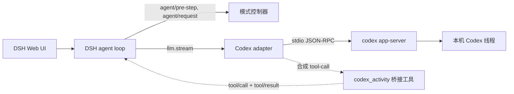

<p align="center">
  
</p>

<h1 align="center">本机 Codex 模式</h1>

<p align="center"><b>把 DeepSeek Harness 的单个会话交给本机 Codex CLI，并在同一对话流里实时看它干活。</b></p>

<p align="center">
  <a href="https://github.com/Anzerwhite/dsh-local-codex/releases"></a>
  <a href="./LICENSE"></a>
  
  
  
  <a href="https://github.com/Anzerwhite/dsh-local-codex/stargazers"></a>
</p>

<p align="center">
  <a href="./README.md">English</a> ·
  <a href="#安装">安装</a> ·
  <a href="#快速开始">快速开始</a> ·
  <a href="#配置">配置</a> ·
  <a href="./docs/design.md">设计文档</a> ·
  <a href="./CHANGELOG.md">更新日志</a>
</p>

`dsh-local-codex` 是 [DeepSeek Harness](https://github.com/deepseek-ai/deepseek-harness)（DSH）的 Host 插件：把**一个会话**交给本机 **Codex CLI**。在会话里发一句「使用codex模式」（或执行 `/codex on`），该会话就切换到 Codex：回复直接流式显示在现有聊天里，Codex 执行的命令、文件改动会以 DSH 原生可折叠工具卡片出现在同一对话流中。

模式**按会话生效**。新会话与 fork 默认关闭；DSH 重启后重开同一会话会续接同一个 Codex 线程；一个会话切到 Codex 不会改变 DSH 工作区里其它会话的行为。

```text
你:    使用codex模式：跑一下单元测试，失败的话修掉
DSH:   ✓ 本会话 Codex 模式已开启 → codex/<你的 Codex 模型>
Codex: 我先跑一遍测试。
       ▸ codex_activity   (pnpm test — 退出码 1)
       …
       修好失败断言，重新跑通。
```

## 目录

- [为什么用本机 Codex 模式](#为什么用本机-codex-模式)
- [功能](#功能)
- [环境要求与兼容性](#环境要求与兼容性)
- [安装](#安装)
- [快速开始](#快速开始)
- [触发词与命令](#触发词与命令)
- [配置](#配置)
- [工作原理](#工作原理)
- [权限与安全](#权限与安全)
- [限制](#限制)
- [常见问题](#常见问题)
- [路线图](#路线图)
- [开发](#开发)
- [许可证](#许可证)

## 为什么用本机 Codex 模式

- **用你已配置好的 Codex。** 同一份 `~/.codex/config.toml`、同一个 provider、同一个模型、同样的 hooks/skills/插件——不需要第二个账号，也不需要重新登录。
- **不复制上下文。** DSH 会话本身就是 Codex 对话；只维护一条时间线，而不是在聊天窗口和终端之间来回粘贴。
- **原生 DSH 体验。** 流式回复、工具卡片、审批卡片、停止按钮、会话历史、持久化与新会话行为，全部由 DSH 本身提供。
- **范围明确。** 只有你开启的那个会话受影响；新会话、fork 以及其它 DSH 会话仍使用原本的模型和工具。
- **退出不留尾巴。** `/codex off` 会恢复进入前的 DSH 模型路由，并释放 Codex 线程占用，让原生 Codex 可以重新打开该会话。

## 功能

| 功能 | 说明 |
| --- | --- |
| 单会话接管 | 触发词或 `/codex on\|off\|status` 控制单个会话；仅在该会话中 DSH 模型与工具让位。 |
| 同频流式显示 | Codex 正文走 DSH 标准助手流式通道。 |
| 原生工具卡片 | 命令执行、文件改动、MCP 调用、网页搜索会落成真实的 `tool/call` + `tool/result`，由 DSH 可折叠工具卡片渲染。 |
| 本机 Codex 运行时 | 驱动 `codex app-server`，完全沿用你的 Codex 配置；每个 DSH 会话对应一个 Codex 线程。 |
| 思考强度 | 向 DSH 暴露 `minimal` / `low` / `medium` / `high` / `xhigh` 档位，逐轮传给 Codex（`max` → `xhigh`）。 |
| 会话级持久化 | 模式与 Codex thread id 按会话存储；DSH 重启后重开会话会 resume 同一线程。 |
| 权限以 DSH 为准 | 会话的 sandbox/approval 预设映射为 Codex 每轮的 `sandboxPolicy` / `approvalPolicy`；Codex 审批变成 DSH 审批卡片。 |
| 停止与恢复 | 点停止会中断当前 Codex 轮并保留已输出内容；失败显示可读错误并在下一轮重建 app-server。 |
| 释放线程占用 | `/codex off` 会对线程 `thread/unsubscribe`，app-server 立即卸载，原生 Codex 可重新打开会话。 |
| 附件 | 输入框图片以 `localImage` 传给 Codex；文件落盘并把路径告知 Codex。 |
| 零前端改动 | 全部通过标准会话事件与现有 DSH Web UI 呈现，无客户端包。 |

## 环境要求与兼容性

| 组件 | 版本 / 要求 |
| --- | --- |
| DeepSeek Harness | `0.2.1-rc.x`，Web profile（纯 Host 插件，无前端包） |
| Codex CLI | `0.170.x`，默认路径 `/root/.npm-global/bin/codex`，可用 `codexBin` 覆盖 |
| Codex 配置 | `~/.codex/config.toml`（支持自定义 provider；只有 provider 需要时才要 `codex login`） |
| 包管理器 | profile 环境可执行 `pnpm`（DSH Plugin Manager 安装 `zod` 时使用） |
| 模型访问 | Codex 安装可访问的 provider；插件不管理 Codex 凭据 |
| 平台 | DSH 与 Codex CLI 能运行的平台；默认 `codexBin` 是 Linux 路径，其它平台请显式配置 |

> `codex app-server` 在 Codex 中属于 experimental。本版本以 Codex CLI **0.170.x** 协议为基线，并容忍未知通知；升级 Codex 可能需要一次兼容性回归。

## 安装

### 通过插件市场 / 预构建 Release 包

```sh
dsh plugin --profile web add https://github.com/Anzerwhite/dsh-local-codex/releases/download/v0.1.0/dsh-local-codex-0.1.0.tgz
```

这与 DSH 插件市场提供的预构建 tarball 相同。插件已收录进社区目录（`awesome-dsh-plugin`）；市场与 Discover 的索引会按自己的节奏重建，刷新后即可在应用内搜索到。预构建 tarball 可立即安装同一份产物。

### 通过 npm（npm 发布后）

```sh
dsh plugin --profile web add dsh-local-codex
```

### 从源码（开发）

```sh
git clone https://github.com/Anzerwhite/dsh-local-codex.git
cd dsh-local-codex
dsh plugin --profile web add -w "$PWD"
```

修改源码后，在 **插件** 页把本 bundle 关闭再开启（或重启 `dsh web`）以加载新模块。

### 卸载

```sh
dsh plugin --profile web remove dsh-local-codex
```

卸载会保留每个会话已保存的模式记录（无害），并释放插件持有的 Codex 线程。

## 快速开始

1. 安装插件并重载/重启 DSH profile。
2. 打开一个会话（模型选择器仍显示你平时的 DSH 模型）。
3. 发送 `使用codex模式`（或 `/codex on`），之后正常和 Codex 对话即可。

## 触发词与命令

触发词需位于消息句首，不区分大小写；触发词本身不进入模型历史。

| 操作 | 发送内容 |
| --- | --- |
| 开启（不带内容） | `使用codex模式` / `开启codex模式` / `进入codex模式` / `切换到codex模式` / `use codex mode` / `enable codex mode` / `enter codex mode` / `codex mode on` |
| 开启并附带任务 | `使用codex模式：帮我修复这个测试` —— 开启模式并把「帮我修复这个测试」作为第一轮发给 Codex |
| 关闭 | `退出codex模式` / `关闭codex模式` / `结束codex模式` / `exit codex mode` / `disable codex mode` / `codex mode off` |
| 显式控制 | `/codex on` · `/codex off` · `/codex status` |

模式开启期间，会话模型显示为 `codex/<你的 Codex 模型>`；`/codex status` 会报告模型、思考强度与 Codex thread id。

## 配置

一般无需配置，默认值针对常见的本机 Codex 安装。需要覆盖时，在 profile patch（`cordis.patch.yml`）的插件行里加 `config`：

```yaml
- id: codex-mode
  config:
    codexBin: /root/.npm-global/bin/codex
    reasoningEffort: xhigh
```

| 键 | 默认 | 含义 |
| --- | --- | --- |
| `codexBin` | `/root/.npm-global/bin/codex` | Codex CLI 可执行文件。 |
| `providerName` | `codex` | 注册给 DSH 的 LLM provider 路由名。 |
| `model` | `~/.codex/config.toml` 的 `model` | 暴露给 DSH 模型选择器的模型 id。 |
| `cwd` | 会话工作目录 | 覆盖 Codex 线程工作目录。 |
| `requestTimeoutMs` | `60000` | app-server 单请求超时。 |
| `bootstrapLimitChars` | `24000` | 首次创建 Codex 线程时注入的历史摘要字符预算。 |
| `reasoningEffort` | Codex 配置的 `model_reasoning_effort` | 默认思考强度。 |
| `reasoningSummary` | Codex 配置 | 逐轮 summary 覆盖（`auto` / `concise` / `detailed` / `none`）。 |
| `codexEfforts` | 内置五档 | 暴露给 DSH 的思考档位。 |
| `maxBridgeCallsPerTurn` | `200` | 单个用户轮内桥接动作预算（安全阀）。 |
| `defaultSandbox` / `defaultApproval` | `danger-full-access` / `never` | 读不到 DSH 权限预设时的回退值。 |
| `attachmentsDir` | 系统临时目录 | 附件物化目录。 |

## 工作原理



插件注册一个 **LLM provider adapter** 驱动 `codex app-server` —— 每个 DSH 会话对应一个 Codex 线程。助手正文与推理通过标准 stream chunk 回传；工具活动经桥接工具落成真实会话事件，现有聊天 UI 可直接渲染。模式控制器负责会话状态、模型路由与权限映射。无需修改 DSH 内核，也无需前端插件。

| 事实 | 值 |
| --- | --- |
| npm 包 | `dsh-local-codex` |
| Bundle 行 id | `codex-mode` |
| LLM provider 路由 | `codex` |
| 展示用工具 | `codex_activity` |
| 客户端包 | 无（纯 Host 插件） |

更多： [设计文档](docs/design.md) · [架构决策](docs/adr/) · [实现契约](docs/impl-contract.md) · [验收记录](docs/verification.md)。

## 权限与安全

- **以 DSH 权限预设为准。** 每个 Codex 轮次都会拿到由 DSH 会话预设映射出的 sandbox/approval（`read-only` / `workspace-write` / `danger-full-access`）。若使用 `danger-full-access`，Codex 命令拥有完整本机权限——需要更严格限制时请先切换会话预设。
- **审批。** Codex 发起的审批请求会转成 DSH 审批卡片；拒绝或取消会终止对应 Codex 动作。
- **线程占用。** 模式开启期间 DSH 持有 Codex 线程，原生 Codex 会显示会话被占用；`/codex off`、agent 销毁或插件卸载会释放。
- **隐私。** 对话内容会发往你 Codex 配置中指定的模型 provider——与直接使用 Codex 的信任边界相同。
- **最小面。** 插件只注册一个展示用工具（`codex_activity`），不会重跑 Codex 命令，也不新增网络端点。
- **凭据。** 尊重 DSH 的审批与权限设置；插件不读取你的 Codex 认证文件。

## 限制

- 恢复 Codex 线程后的第一轮可能耗时 5–30 秒（Codex hooks/skills 加载），暂无进度提示。
- 思考**正文**取决于 provider：部分 provider 只返回 reasoning token 计数；思考**档位**仍然可见、可切换。
- 附件（图片/文件）已实现但尚未大规模验证；超大工具输出受 DSH spill 策略限制。
- 若其它插件也会拉起 `codex app-server`（例如远程工作区插件），建议同时只运行一个，避免线程写锁竞争。
- Codex 动作当前使用 DSH 通用工具卡片；原生终端/diff 卡片在路线图中。

## 常见问题

| 现象 | 处理 |
| --- | --- |
| 刚开启时 `/codex status` 显示线程「尚未创建」 | 正常；线程会在下一条消息时创建。 |
| 原生 Codex 提示会话被锁定 | Codex 模式仍持有线程；先执行 `/codex off`。 |
| 开启后第一条回复很慢 | 线程创建/resume 加 hooks 加载需要时间；后续轮次会快。 |
| 模型选择器看不到 codex 模型 | 确认插件已在 **插件 → 已安装** 激活，且 `codexBin` 指向可运行的 Codex。 |
| 触发词没反应 | 触发词必须在消息句首；也可用 `/codex on`。 |
| 插件无法激活 | profile 需要能执行 `pnpm` 安装依赖；查看 DSH 日志中失败的插件行。 |

## 路线图

- npm 发布（社区目录收录已完成合并）。
- 可选的 Codex 动作原生终端/diff 卡片。
- 附件与 Codex 审批往返的端到端覆盖。
- Codex 线程 resume 时的进度提示。

## 开发

```sh
node test/scenarios.mjs            # headless 端到端场景（S1–S3）
node test/run-headless.mjs --help  # 带断言的单轮 headless runner
```

修改模块边界前请先读 [docs/impl-contract.md](docs/impl-contract.md)。`src/` 为无构建步骤的纯 ESM JavaScript。

## 许可证

[MIT](./LICENSE)

---

<sub>与 OpenAI、DeepSeek 均无隶属关系。Codex 是 OpenAI 的 CLI；DeepSeek Harness 是独立项目。本插件只在本机把两者连接起来。</sub>
