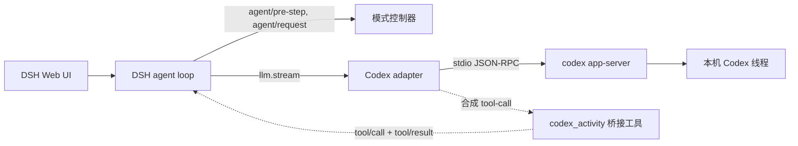

<p align="center">
  
</p>

<h1 align="center">本机 Codex 模式</h1>

<p align="center">
  把 DeepSeek Harness 的单个会话交给本机 Codex CLI，并在同一对话流里实时看它干活。
</p>

<p align="center">
  <a href="./README.md">English</a> ·
  <a href="https://github.com/Anzerwhite/dsh-local-codex/releases">Releases</a> ·
  <a href="./LICENSE">MIT License</a> ·
  <a href="./docs/design.md">设计文档</a>
</p>

`dsh-local-codex` 是 [DeepSeek Harness](https://github.com/deepseek-ai/deepseek-harness)（DSH）的 Host 插件：在一个会话里发一句「使用codex模式」（或执行 `/codex on`），该会话就交给本机 **Codex CLI** 处理——回复直接流式显示在现有聊天里，Codex 执行的命令、文件改动以 DSH 原生可折叠工具卡片的形式出现在同一对话流中。

模式**按会话生效**：新会话与 fork 默认关闭；DSH 重启后重开同一会话会续接同一个 Codex 线程。不需要另开窗口，也不需要复制粘贴记录。

> 状态：`0.1.0` · DSH `0.2.1-rc.x` · Codex CLI `0.170.x` · 纯 Host 插件，无前端包

## 功能

- **单会话接管** — 触发词或 `/codex on` 后，仅该会话改由本机 Codex 处理，DSH 自己的模型与工具在该会话中让位。
- **同频显示** — Codex 正文走 DSH 标准助手流式通道；命令执行、文件改动、MCP 调用、网页搜索会落成真实的 `tool/call` / `tool/result`，由 DSH 原生工具卡片渲染。
- **用你自己的 Codex** — 本机 `codex app-server` 完全沿用 `~/.codex/config.toml`：模型、provider、认证、hooks、skills、插件都与你直接用 Codex 时一致。
- **思考强度** — 向 DSH 暴露 Codex 的 `minimal` / `low` / `medium` / `high` / `xhigh` 档位，选定档位逐轮传给 Codex（DSH 的 `max` 映射为 `xhigh`）。
- **会话级持久化** — 模式与 Codex thread id 按会话存储。DSH 重启后重开该会话会 resume 同一 Codex 线程；新会话与 fork 默认关闭。
- **权限以 DSH 为准** — 会话的 sandbox/approval 预设会映射为 Codex 每轮的 `sandboxPolicy` / `approvalPolicy`；Codex 发起的审批会变成 DSH 原生审批卡片。
- **停止与失败可控** — 点停止会中断当前 Codex 轮（已输出内容保留）；失败显示可读错误，并在下一轮自动重建 app-server。
- **不留线程锁** — `/codex off` 会对 Codex 线程 `thread/unsubscribe`，app-server 配置为立即卸载，原生 Codex TUI 可马上重新打开该会话。
- **附件** — 输入框图片以 `localImage` 传给 Codex；文件落盘并把路径告知 Codex。
- **零前端改动** — 全部通过标准会话事件与现有 DSH Web UI 呈现。

## 环境要求

| 要求 | 说明 |
| --- | --- |
| DeepSeek Harness `0.2.1-rc.x` | Web profile；插件为纯 Host 插件。 |
| Codex CLI `0.170.x` | 默认路径 `/root/.npm-global/bin/codex`，可用 `codexBin` 覆盖；沿用 `~/.codex/config.toml`（支持自定义 provider，只有 provider 需要时才要 `codex login`）。 |
| profile 环境可执行 `pnpm` | DSH Plugin Manager 安装依赖（`zod`）时使用。 |
| Codex 可访问的模型 provider | 插件不管理 Codex 凭据。 |

## 安装

### 通过插件市场 / 预构建 Release 包（当前可用）

```sh
dsh plugin --profile web add https://github.com/Anzerwhite/dsh-local-codex/releases/download/v0.1.0/dsh-local-codex-0.1.0.tgz
```

目录条目合并后，DSH 插件市场也会使用同一个 tarball 一键安装。

### 通过 npm（npm 发布后）

```sh
dsh plugin --profile web add dsh-local-codex
```

### 从源码（开发）

```sh
git clone https://github.com/Anzerwhite/dsh-local-codex.git
cd dsh-local-codex
dsh plugin --profile web add -w "$PWD"
```

修改源码后，在 DSH 的 Plugin Manager 里把本 bundle 关闭再开启（或重启 `dsh web`）以加载新模块。

## 使用

打开任意会话（模型选择器仍显示你平时的 DSH 模型），然后：

| 发送内容 | 效果 |
| --- | --- |
| `使用codex模式` | 为该会话开启 Codex 模式；触发词本身不进入模型历史，并显示一张控制回执。 |
| `使用codex模式：帮我修复这个测试` | 开启模式，并把「帮我修复这个测试」作为第一轮发给 Codex。 |
| `/codex on` · `/codex off` · `/codex status` | 显式控制命令（不产生模型消息）；`status` 会报告模型、思考强度与 Codex thread id。 |
| `退出codex模式` | 关闭模式，恢复进入前的 DSH 模型路由，并释放 Codex 线程占用。 |

触发词（句首、不区分大小写）：

- 开启：`使用codex模式`、`开启codex模式`、`进入codex模式`、`切换到codex模式`、`use codex mode`、`enable codex mode`、`enter codex mode`、`codex mode on`
- 关闭：`退出codex模式`、`关闭codex模式`、`结束codex模式`、`exit codex mode`、`disable codex mode`、`codex mode off`

模式开启期间，该会话模型显示为 `codex/<你 Codex 配置中的模型>`，DSH 模型选择器会同步反映；新会话仍默认使用普通 DSH 模型。

## 配置

一般无需配置，默认值针对常见的本机 Codex 安装。需要调整时，在 profile patch（`cordis.patch.yml`）的插件行里加 `config`：

```yaml
- id: codex-mode
  config:
    codexBin: /root/.npm-global/bin/codex
    reasoningEffort: xhigh
```

| 键 | 默认 | 含义 |
| --- | --- | --- |
| `codexBin` | `/root/.npm-global/bin/codex` | Codex CLI 可执行文件。 |
| `providerName` | `codex` | 注册给 DSH 的 LLM provider 路由名。 |
| `model` | `~/.codex/config.toml` 的 `model` | 暴露给模型选择器的模型 id。 |
| `cwd` | 会话工作目录 | 覆盖 Codex 线程工作目录。 |
| `requestTimeoutMs` | `60000` | app-server 单请求超时。 |
| `bootstrapLimitChars` | `24000` | 首次创建 Codex 线程时注入的历史摘要字符预算。 |
| `reasoningEffort` | Codex 配置的 `model_reasoning_effort` | 默认思考强度。 |
| `reasoningSummary` | Codex 配置 | 逐轮 `summary` 覆盖（`auto` / `concise` / `detailed` / `none`）。 |
| `codexEfforts` | 内置五档 | 暴露给 DSH 的思考档位。 |
| `maxBridgeCallsPerTurn` | `200` | 单个用户轮内桥接动作预算（安全阀）。 |
| `defaultSandbox` / `defaultApproval` | `danger-full-access` / `never` | 读不到 DSH 权限预设时的回退值。 |
| `attachmentsDir` | 系统临时目录 | 附件物化目录。 |

## 工作原理



插件注册一个 **LLM provider adapter** 驱动 `codex app-server`，每个 DSH 会话对应一个 Codex 线程。正文与推理通过标准 stream chunk 回传；工具活动通过桥接工具落成真实会话事件，因此现有聊天 UI 可以直接渲染。模式控制器负责会话状态、模型路由与权限映射。无需修改 DSH 内核，也无需前端插件。

更多： [设计文档](docs/design.md) · [架构决策](docs/adr/) · [实现契约](docs/impl-contract.md) · [验收记录](docs/verification.md)。

## 权限与安全

- **以 DSH 预设为准**：每个 Codex 轮次都会拿到由 DSH 会话权限预设映射出的 sandbox/approval（`read-only` / `workspace-write` / `danger-full-access`）。如果你的默认预设是 `danger-full-access`，Codex 命令会拥有完整本机权限——需要更严格限制时请先切换会话预设。
- **审批**：Codex 发起的审批请求会转成 DSH 审批卡片；拒绝或取消会终止对应 Codex 动作。
- **线程占用**：模式开启期间由 DSH 持有 Codex 线程，原生 Codex 会显示该会话被占用；`/codex off`、agent 销毁或插件卸载会释放。
- **隐私**：对话内容会发往你 Codex 配置中指定的模型 provider——与直接用 Codex 的信任边界相同。
- 插件只注册一个**展示用**工具（`codex_activity`），不会重跑任何 Codex 命令。

## 兼容性与限制

- `codex app-server` 在 Codex 中属于 experimental；本版本以 **Codex CLI 0.170.x** 协议为基线，并容忍未知通知。升级 Codex 可能需要一次兼容性回归。
- 恢复 Codex 线程后的第一轮可能耗时 5–30 秒（Codex hooks/skills 加载），暂无进度提示。
- 思考**正文**取决于 provider：部分 provider 只返回 reasoning token 计数；但思考**档位**仍然可见、可切换。
- 附件（图片/文件）已实现但尚未大规模真实场景验证；超大工具输出受 DSH spill 策略限制。
- 若其他插件也会拉起 `codex app-server`（例如远程工作区插件），建议同时只运行一个，避免线程写锁竞争。

## 常见问题

| 现象 | 处理 |
| --- | --- |
| 开启后 `/codex status` 显示线程「(尚未创建)」 | 正常；下一条消息才会创建 Codex 线程。 |
| 原生 Codex 提示会话被锁定 | Codex 模式仍持有该线程：先执行 `/codex off`。 |
| 开启后第一条回复很慢 | 线程创建/resume 加 hooks 加载需要时间；后续轮次会快很多。 |
| 模型选择器看不到 codex 模型 | 确认插件已激活（Plugins → Installed），且 `codexBin` 指向的 Codex 能运行。 |
| 触发词没反应 | 触发词必须在消息句首；也可用 `/codex on`。 |

## 路线图

- npm 发布与插件市场目录上架。
- 可选的 Codex 动作原生终端/diff 卡片（当前使用 DSH 通用工具卡片）。
- 附件与 Codex 审批往返的端到端覆盖。
- Codex 线程 resume 时的进度提示。

## 开发

```sh
node test/scenarios.mjs            # headless 端到端场景（S1–S3）
node test/run-headless.mjs --help  # 带断言的单轮 headless runner
```

修改模块边界前请先读 [docs/impl-contract.md](docs/impl-contract.md)。`src/` 下为无构建步骤的纯 ESM JavaScript。

## 许可证

[MIT](./LICENSE)
